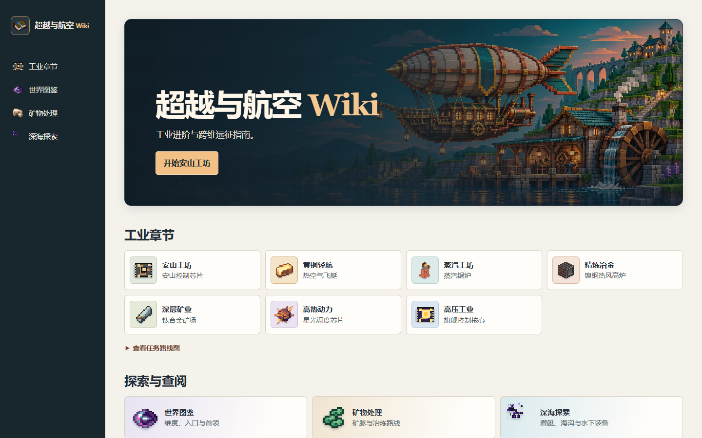
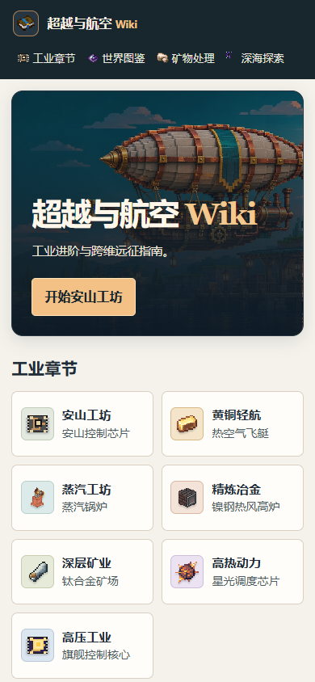

# 超越与航空 Wiki

Minecraft 1.21.1 整合包《超越与航空》的图文指南。从安山工坊开始，按阶段查机器、矿物和探索路线。

[GitHub Pages](https://jeremyguo.github.io/above-and-beyond-aeronautics-wiki/) · [打开在线 Wiki](https://above-and-beyond-aeronautics-wiki.victor-j.chatgpt.site/) · [世界图鉴](https://above-and-beyond-aeronautics-wiki.victor-j.chatgpt.site/worlds/index.html) · [矿物处理](https://above-and-beyond-aeronautics-wiki.victor-j.chatgpt.site/metallurgy.html)

## 指南内容

- **工业章节**　七个阶段的开工步骤、机器实机图和完整依赖图。
- **世界图鉴**　十个维度的入口、矿物、首领和剧情。
- **矿物处理**　按矿物查看加工路线、配方和产率。

手机预览

静态网页源文件位于 [wiki](wiki/)。封面为原创生成插画，物品图标与实机画面来自整合包及相关模组。
